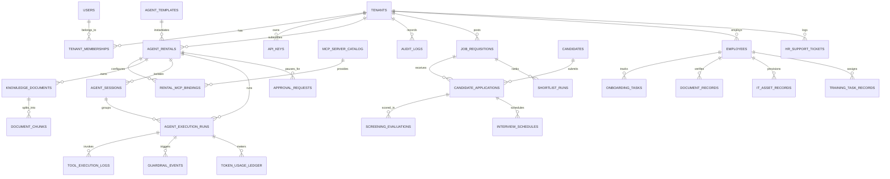

# Rent-an-Agent (Hiring & HR Category) — Database & Storage Design

> **Status:** Proposed Architecture (Design Phase — No Code Implemented Yet)

---

## 1. Multi-Tenant Persistence Strategy

### 1.1 Choice: Shared PostgreSQL 16+ with Mandatory Row-Level Security (RLS)
* **Why Needed:** HR tenants require strict cryptographic/database-engine data isolation across candidate resumes, interview scorecards, KYC documents, and compensation analytics, while keeping SaaS unit economics sustainable across hundreds or thousands of SMB/enterprise rentals.
* **Alternatives Evaluated:**
  1. *SQLite per file (`EnterpriseFlow AI` Reference Repo):* Zero setup for single-user local demos, but lacks concurrency control, native `pgvector`, and Row-Level Security.
  2. *Database-per-Tenant (Silo):* Strongest isolation, but unmanageable Alembic schema migrations and connection pool exhaustion beyond ~100 tenants.
  3. *App-Level `WHERE tenant_id = ?` Only:* Fragile—a single omitted filter in an analytical view or LangGraph tool exposes cross-tenant data.
* **Limitations:** Requires strict discipline so migration roles use `OWNER` privileges cleanly while the application runtime role operates **without `BYPASSRLS`**, and requires transaction-scoped `SET LOCAL` when running behind connection poolers (PgBouncer / `asyncpg`).

### 1.2 Transaction-Scoped RLS Pattern (Connection Pool Safe)
Every tenant-scoped database session executes inside an explicit transaction block:
```sql
BEGIN;
SELECT set_config('app.current_tenant', '550e8400-e29b-41d4-a716-446655440000', true);
-- All subsequent SELECT/INSERT/UPDATE/DELETE queries inherit app.current_tenant
-- and automatically reset on COMMIT/ROLLBACK before connection returns to pool.
COMMIT;
```

---

## 2. Entity-Relationship Diagram (ERD)



---

## 3. Core PostgreSQL Schema & DDL

### 3.1 Control Plane: Tenants, Users & Marketplace

```sql
CREATE EXTENSION IF NOT EXISTS pgcrypto;
CREATE EXTENSION IF NOT EXISTS vector;

-- Global Catalog (Readable by all authenticated users, writable by Platform Admin only)
CREATE TABLE agent_templates (
    template_id      UUID PRIMARY KEY DEFAULT gen_random_uuid(),
    slug             VARCHAR(64) UNIQUE NOT NULL, -- e.g. 'recruitment-screening', 'employee-onboarding'
    name             VARCHAR(120) NOT NULL,
    category         VARCHAR(40) NOT NULL DEFAULT 'hiring_hr',
    description      TEXT NOT NULL,
    base_system_prompt TEXT NOT NULL,
    default_allowed_tools JSONB NOT NULL DEFAULT '[]'::jsonb,
    domain_anchors   JSONB NOT NULL DEFAULT '{}'::jsonb, -- positive & OOD anchor phrases
    default_model_tier VARCHAR(20) NOT NULL DEFAULT 'tier_2_flash',
    version          VARCHAR(20) NOT NULL DEFAULT '1.0.0',
    is_active        BOOLEAN NOT NULL DEFAULT TRUE,
    created_at       TIMESTAMPTZ NOT NULL DEFAULT now()
);

CREATE TABLE mcp_server_catalog (
    mcp_id           UUID PRIMARY KEY DEFAULT gen_random_uuid(),
    slug             VARCHAR(64) UNIQUE NOT NULL, -- 'greenhouse', 'google-calendar', 'slack', 'okta-mock'
    display_name     VARCHAR(100) NOT NULL,
    transport_type   VARCHAR(20) NOT NULL,        -- 'streamable_http', 'stdio_sandbox', 'mock'
    compressed_tools JSONB NOT NULL,              -- stripped schemas for token optimization
    auth_scheme      VARCHAR(30) NOT NULL,        -- 'oauth2', 'api_key', 'none'
    is_active        BOOLEAN NOT NULL DEFAULT TRUE
);

CREATE TABLE tenants (
    tenant_id        UUID PRIMARY KEY DEFAULT gen_random_uuid(),
    name             VARCHAR(150) NOT NULL,
    slug             VARCHAR(80) UNIQUE NOT NULL,
    plan_tier        VARCHAR(30) NOT NULL DEFAULT 'starter',
    status           VARCHAR(20) NOT NULL DEFAULT 'active',
    created_at       TIMESTAMPTZ NOT NULL DEFAULT now()
);

CREATE TABLE users (
    user_id          UUID PRIMARY KEY DEFAULT gen_random_uuid(),
    email            VARCHAR(255) UNIQUE NOT NULL,
    full_name        VARCHAR(150) NOT NULL,
    password_hash    TEXT,
    sso_subject      VARCHAR(255),
    created_at       TIMESTAMPTZ NOT NULL DEFAULT now()
);

CREATE TABLE tenant_memberships (
    membership_id    UUID PRIMARY KEY DEFAULT gen_random_uuid(),
    tenant_id        UUID NOT NULL REFERENCES tenants(tenant_id) ON DELETE CASCADE,
    user_id          UUID NOT NULL REFERENCES users(user_id) ON DELETE CASCADE,
    role             VARCHAR(30) NOT NULL, -- 'TENANT_ADMIN', 'HR_MANAGER', 'RECRUITER', 'EMPLOYEE'
    created_at       TIMESTAMPTZ NOT NULL DEFAULT now(),
    UNIQUE (tenant_id, user_id)
);

CREATE TABLE api_keys (
    key_id           UUID PRIMARY KEY DEFAULT gen_random_uuid(),
    tenant_id        UUID NOT NULL REFERENCES tenants(tenant_id) ON DELETE CASCADE,
    name             VARCHAR(100) NOT NULL,
    key_prefix       VARCHAR(16) NOT NULL,
    key_hash         TEXT NOT NULL UNIQUE, -- SHA-256 / Argon2 hash
    scopes           JSONB NOT NULL DEFAULT '[]'::jsonb,
    expires_at       TIMESTAMPTZ,
    created_at       TIMESTAMPTZ NOT NULL DEFAULT now()
);
```

### 3.2 Per-Rental Configuration, MCP Bindings & Knowledge Base

```sql
CREATE TABLE agent_rentals (
    rental_id            UUID PRIMARY KEY DEFAULT gen_random_uuid(),
    tenant_id            UUID NOT NULL REFERENCES tenants(tenant_id) ON DELETE CASCADE,
    template_id          UUID NOT NULL REFERENCES agent_templates(template_id),
    display_name         VARCHAR(120) NOT NULL,
    status               VARCHAR(20) NOT NULL DEFAULT 'active', -- 'active', 'paused', 'retired'
    custom_persona_prompt TEXT NOT NULL DEFAULT '',
    config_hash          VARCHAR(64) NOT NULL,                  -- invalidates prompt cache cleanly
    allowed_tools        JSONB NOT NULL DEFAULT '[]'::jsonb,
    allowed_domains      JSONB NOT NULL DEFAULT '[]'::jsonb,    -- Playwright domain allowlist
    guardrail_policy     JSONB NOT NULL DEFAULT '{}'::jsonb,    -- blind_screening, hitl_rules, pii_mode
    model_routing_policy JSONB NOT NULL DEFAULT '{}'::jsonb,
    monthly_token_quota  BIGINT NOT NULL DEFAULT 2000000,
    kb_version_hash      VARCHAR(64) NOT NULL DEFAULT 'v1',     -- invalidates semantic cache on KB update
    created_at           TIMESTAMPTZ NOT NULL DEFAULT now(),
    updated_at           TIMESTAMPTZ NOT NULL DEFAULT now()
);
CREATE INDEX idx_rentals_tenant ON agent_rentals (tenant_id, status);

CREATE TABLE rental_mcp_bindings (
    binding_id       UUID PRIMARY KEY DEFAULT gen_random_uuid(),
    tenant_id        UUID NOT NULL REFERENCES tenants(tenant_id) ON DELETE CASCADE,
    rental_id        UUID NOT NULL REFERENCES agent_rentals(rental_id) ON DELETE CASCADE,
    mcp_id           UUID NOT NULL REFERENCES mcp_server_catalog(mcp_id),
    enabled_tools    JSONB NOT NULL DEFAULT '[]'::jsonb,
    vault_secret_ref TEXT,           -- Reference key or KMS-encrypted JSON envelope (never plain API key)
    is_enabled       BOOLEAN NOT NULL DEFAULT TRUE,
    created_at       TIMESTAMPTZ NOT NULL DEFAULT now(),
    UNIQUE (rental_id, mcp_id)
);

CREATE TABLE knowledge_documents (
    doc_id           UUID PRIMARY KEY DEFAULT gen_random_uuid(),
    tenant_id        UUID NOT NULL REFERENCES tenants(tenant_id) ON DELETE CASCADE,
    rental_id        UUID NOT NULL REFERENCES agent_rentals(rental_id) ON DELETE CASCADE,
    title            VARCHAR(255) NOT NULL,
    source_type      VARCHAR(30) NOT NULL, -- 'handbook', 'rubric', 'jd_template', 'resume'
    storage_uri      TEXT NOT NULL,        -- s3://bucket/{tenant_id}/{rental_id}/{doc_id}
    sha256_checksum  VARCHAR(64) NOT NULL,
    min_role_access  VARCHAR(30) NOT NULL DEFAULT 'EMPLOYEE', -- RBAC visibility inside RAG
    chunk_count      INTEGER NOT NULL DEFAULT 0,
    status           VARCHAR(20) NOT NULL DEFAULT 'indexed',
    created_at       TIMESTAMPTZ NOT NULL DEFAULT now()
);

CREATE TABLE document_chunks (
    chunk_id         UUID PRIMARY KEY DEFAULT gen_random_uuid(),
    tenant_id        UUID NOT NULL REFERENCES tenants(tenant_id) ON DELETE CASCADE,
    rental_id        UUID NOT NULL REFERENCES agent_rentals(rental_id) ON DELETE CASCADE,
    doc_id           UUID NOT NULL REFERENCES knowledge_documents(doc_id) ON DELETE CASCADE,
    chunk_index      INTEGER NOT NULL,
    section_title    VARCHAR(200),
    content          TEXT NOT NULL,
    token_count      INTEGER NOT NULL,
    embedding        vector(768) NOT NULL, -- Dimension matched to chosen embedding model
    tsv              tsvector GENERATED ALWAYS AS (to_tsvector('english', content)) STORED
);
CREATE INDEX idx_chunks_tenant_rental ON document_chunks (tenant_id, rental_id);
CREATE INDEX idx_chunks_hnsw ON document_chunks USING hnsw (embedding vector_cosine_ops);
CREATE INDEX idx_chunks_fts ON document_chunks USING gin (tsv);
```

### 3.3 LangGraph Checkpointer Isolation (`agent_sessions`)

```sql
-- Companion RLS-protected table ensuring LangGraph thread_id cannot cross tenant boundaries
CREATE TABLE agent_sessions (
    thread_id        UUID PRIMARY KEY DEFAULT gen_random_uuid(),
    tenant_id        UUID NOT NULL REFERENCES tenants(tenant_id) ON DELETE CASCADE,
    rental_id        UUID NOT NULL REFERENCES agent_rentals(rental_id) ON DELETE CASCADE,
    created_by       UUID REFERENCES users(user_id),
    title            VARCHAR(200),
    summary_memory   TEXT DEFAULT '',
    status           VARCHAR(30) NOT NULL DEFAULT 'active', -- 'active', 'paused_hitl', 'completed'
    created_at       TIMESTAMPTZ NOT NULL DEFAULT now(),
    updated_at       TIMESTAMPTZ NOT NULL DEFAULT now()
);
CREATE INDEX idx_sessions_tenant_rental ON agent_sessions (tenant_id, rental_id, updated_at DESC);
```
> **Invariant:** Every request must pass `SELECT 1 FROM agent_sessions WHERE thread_id = :id AND rental_id = :rental_id` under active PostgreSQL RLS **before** invoking `AsyncPostgresSaver`.

### 3.4 Hiring & HR Domain Tables (Including Multi-Tenant Upgrade of Reference Models)

```sql
-- Agents 1, 2, 3, 4 (Recruitment, JD, Shortlisting, Scheduling)
CREATE TABLE job_requisitions (
    requisition_id   UUID PRIMARY KEY DEFAULT gen_random_uuid(),
    tenant_id        UUID NOT NULL REFERENCES tenants(tenant_id) ON DELETE CASCADE,
    title            VARCHAR(150) NOT NULL,
    department       VARCHAR(80) NOT NULL,
    seniority_level  VARCHAR(50),
    jd_markdown      TEXT,
    rubric_json      JSONB NOT NULL DEFAULT '{}'::jsonb,
    knockout_rules   JSONB NOT NULL DEFAULT '[]'::jsonb,
    status           VARCHAR(30) NOT NULL DEFAULT 'draft', -- 'draft', 'open', 'closed'
    created_at       TIMESTAMPTZ NOT NULL DEFAULT now()
);

CREATE TABLE candidates (
    candidate_id     UUID PRIMARY KEY DEFAULT gen_random_uuid(),
    tenant_id        UUID NOT NULL REFERENCES tenants(tenant_id) ON DELETE CASCADE,
    full_name        VARCHAR(150) NOT NULL,
    email            VARCHAR(255),
    phone            VARCHAR(40),
    resume_storage_uri TEXT,
    parsed_profile_json JSONB NOT NULL DEFAULT '{}'::jsonb, -- Cached extraction (Token Optimization #10)
    source_channel   VARCHAR(60) DEFAULT 'direct',
    created_at       TIMESTAMPTZ NOT NULL DEFAULT now()
);

CREATE TABLE candidate_applications (
    application_id   UUID PRIMARY KEY DEFAULT gen_random_uuid(),
    tenant_id        UUID NOT NULL REFERENCES tenants(tenant_id) ON DELETE CASCADE,
    requisition_id   UUID NOT NULL REFERENCES job_requisitions(requisition_id) ON DELETE CASCADE,
    candidate_id     UUID NOT NULL REFERENCES candidates(candidate_id) ON DELETE CASCADE,
    stage            VARCHAR(40) NOT NULL DEFAULT 'applied', -- 'applied','screened','shortlisted','interviewing','offered','hired','rejected'
    applied_at       TIMESTAMPTZ NOT NULL DEFAULT now(),
    UNIQUE (tenant_id, requisition_id, candidate_id)
);

CREATE TABLE screening_evaluations (
    evaluation_id    UUID PRIMARY KEY DEFAULT gen_random_uuid(),
    tenant_id        UUID NOT NULL REFERENCES tenants(tenant_id) ON DELETE CASCADE,
    rental_id        UUID NOT NULL REFERENCES agent_rentals(rental_id),
    application_id   UUID NOT NULL REFERENCES candidate_applications(application_id) ON DELETE CASCADE,
    overall_score    NUMERIC(5,2) NOT NULL,
    rubric_breakdown JSONB NOT NULL,
    evidence_quotes  JSONB NOT NULL DEFAULT '[]'::jsonb,
    knockout_passed  BOOLEAN NOT NULL DEFAULT TRUE,
    blind_mode_used  BOOLEAN NOT NULL DEFAULT FALSE,
    created_at       TIMESTAMPTZ NOT NULL DEFAULT now()
);

CREATE TABLE shortlist_runs (
    shortlist_id     UUID PRIMARY KEY DEFAULT gen_random_uuid(),
    tenant_id        UUID NOT NULL REFERENCES tenants(tenant_id) ON DELETE CASCADE,
    rental_id        UUID NOT NULL REFERENCES agent_rentals(rental_id),
    requisition_id   UUID NOT NULL REFERENCES job_requisitions(requisition_id),
    ranked_app_ids   JSONB NOT NULL,
    rationale_json   JSONB NOT NULL,
    approval_status  VARCHAR(30) NOT NULL DEFAULT 'pending_hitl',
    created_at       TIMESTAMPTZ NOT NULL DEFAULT now()
);

CREATE TABLE interview_schedules (
    schedule_id      UUID PRIMARY KEY DEFAULT gen_random_uuid(),
    tenant_id        UUID NOT NULL REFERENCES tenants(tenant_id) ON DELETE CASCADE,
    rental_id        UUID NOT NULL REFERENCES agent_rentals(rental_id),
    application_id   UUID NOT NULL REFERENCES candidate_applications(application_id) ON DELETE CASCADE,
    interviewer_emails JSONB NOT NULL,
    scheduled_start  TIMESTAMPTZ NOT NULL,
    scheduled_end    TIMESTAMPTZ NOT NULL,
    timezone         VARCHAR(64) NOT NULL,
    meeting_link     TEXT,
    external_event_id VARCHAR(255),
    status           VARCHAR(30) NOT NULL DEFAULT 'pending_hitl', -- 'pending_hitl','confirmed','rescheduled','cancelled'
    created_at       TIMESTAMPTZ NOT NULL DEFAULT now()
);

-- Agent 5: Employee Onboarding (Upgraded Multi-Tenant Schema from EnterpriseFlow AI)
CREATE TABLE employees (
    employee_pk      UUID PRIMARY KEY DEFAULT gen_random_uuid(),
    tenant_id        UUID NOT NULL REFERENCES tenants(tenant_id) ON DELETE CASCADE,
    employee_code    VARCHAR(50) NOT NULL, -- e.g. 'EMP-2026-001'
    employee_name    VARCHAR(150) NOT NULL,
    email            VARCHAR(255),
    department       VARCHAR(80) DEFAULT 'Engineering',
    role             VARCHAR(120) DEFAULT 'Software Engineer',
    joining_date     DATE,
    manager          VARCHAR(120),
    buddy            VARCHAR(120),
    team             VARCHAR(120),
    desk             VARCHAR(120),
    onboarding_status VARCHAR(30) NOT NULL DEFAULT 'in_progress',
    created_at       TIMESTAMPTZ NOT NULL DEFAULT now(),
    UNIQUE (tenant_id, employee_code)
);

CREATE TABLE onboarding_tasks (
    task_id          UUID PRIMARY KEY DEFAULT gen_random_uuid(),
    tenant_id        UUID NOT NULL REFERENCES tenants(tenant_id) ON DELETE CASCADE,
    employee_pk      UUID NOT NULL REFERENCES employees(employee_pk) ON DELETE CASCADE,
    task_name        VARCHAR(60) NOT NULL,
    status           VARCHAR(30) NOT NULL DEFAULT 'pending',
    details          TEXT,
    updated_at       TIMESTAMPTZ NOT NULL DEFAULT now()
);

CREATE TABLE document_records (
    doc_record_id    UUID PRIMARY KEY DEFAULT gen_random_uuid(),
    tenant_id        UUID NOT NULL REFERENCES tenants(tenant_id) ON DELETE CASCADE,
    employee_pk      UUID NOT NULL REFERENCES employees(employee_pk) ON DELETE CASCADE,
    doc_name         VARCHAR(100) NOT NULL,
    doc_type         VARCHAR(100),
    readable         BOOLEAN NOT NULL DEFAULT FALSE,
    name_match       BOOLEAN NOT NULL DEFAULT FALSE,
    confidence       VARCHAR(20) NOT NULL DEFAULT 'low',
    masked_metadata  JSONB NOT NULL DEFAULT '{}'::jsonb, -- Masked IDs only (XXXX-XXXX-1234)
    issues           JSONB NOT NULL DEFAULT '[]'::jsonb,
    created_at       TIMESTAMPTZ NOT NULL DEFAULT now()
);

CREATE TABLE it_asset_records (
    asset_id         UUID PRIMARY KEY DEFAULT gen_random_uuid(),
    tenant_id        UUID NOT NULL REFERENCES tenants(tenant_id) ON DELETE CASCADE,
    employee_pk      UUID NOT NULL REFERENCES employees(employee_pk) ON DELETE CASCADE,
    email_account    VARCHAR(255),
    laptop_model     VARCHAR(120),
    software_licenses JSONB NOT NULL DEFAULT '[]'::jsonb,
    ticket_ref       VARCHAR(80),
    status           VARCHAR(30) NOT NULL DEFAULT 'provisioned',
    created_at       TIMESTAMPTZ NOT NULL DEFAULT now()
);

CREATE TABLE training_task_records (
    training_id      UUID PRIMARY KEY DEFAULT gen_random_uuid(),
    tenant_id        UUID NOT NULL REFERENCES tenants(tenant_id) ON DELETE CASCADE,
    employee_pk      UUID NOT NULL REFERENCES employees(employee_pk) ON DELETE CASCADE,
    title            VARCHAR(200) NOT NULL,
    category         VARCHAR(60) DEFAULT 'Orientation',
    status           VARCHAR(30) DEFAULT 'Pending',
    priority         VARCHAR(20) DEFAULT 'medium',
    created_at       TIMESTAMPTZ NOT NULL DEFAULT now()
);

-- Shared HITL Approval Inbox (Covers Shortlisting, Scheduling, Onboarding, Support)
CREATE TABLE approval_requests (
    approval_id      UUID PRIMARY KEY DEFAULT gen_random_uuid(),
    tenant_id        UUID NOT NULL REFERENCES tenants(tenant_id) ON DELETE CASCADE,
    rental_id        UUID NOT NULL REFERENCES agent_rentals(rental_id),
    thread_id        UUID REFERENCES agent_sessions(thread_id),
    subject_ref      VARCHAR(100) NOT NULL, -- application_id or employee_pk
    approval_type    VARCHAR(60) NOT NULL,  -- 'shortlist_signoff', 'interview_invite', 'it_access', 'team_allocation'
    title            VARCHAR(200) NOT NULL,
    description      TEXT NOT NULL,
    payload_preview  JSONB NOT NULL DEFAULT '{}'::jsonb,
    status           VARCHAR(20) NOT NULL DEFAULT 'Pending', -- 'Pending', 'Approved', 'Rejected'
    approver_user_id UUID REFERENCES users(user_id),
    notes            TEXT,
    created_at       TIMESTAMPTZ NOT NULL DEFAULT now(),
    resolved_at      TIMESTAMPTZ
);

-- Agent 6: HR Support Tickets
CREATE TABLE hr_support_tickets (
    ticket_id        UUID PRIMARY KEY DEFAULT gen_random_uuid(),
    tenant_id        UUID NOT NULL REFERENCES tenants(tenant_id) ON DELETE CASCADE,
    rental_id        UUID NOT NULL REFERENCES agent_rentals(rental_id),
    requester_user_id UUID REFERENCES users(user_id),
    category         VARCHAR(60) NOT NULL,
    summary          TEXT NOT NULL,
    external_ref     VARCHAR(100),
    status           VARCHAR(30) NOT NULL DEFAULT 'open',
    created_at       TIMESTAMPTZ NOT NULL DEFAULT now()
);
```

### 3.5 Execution Traces, Guardrails, Token Ledger & Audit Logs

```sql
CREATE TABLE agent_execution_runs (
    run_id           UUID PRIMARY KEY DEFAULT gen_random_uuid(),
    tenant_id        UUID NOT NULL REFERENCES tenants(tenant_id) ON DELETE CASCADE,
    rental_id        UUID NOT NULL REFERENCES agent_rentals(rental_id),
    thread_id        UUID REFERENCES agent_sessions(thread_id),
    user_id          UUID REFERENCES users(user_id),
    otel_trace_id    VARCHAR(64),
    classifier_result VARCHAR(40) NOT NULL, -- 'in_domain', 'rejected_out_of_domain', 'blocked_injection', 'cache_hit'
    status           VARCHAR(30) NOT NULL,  -- 'running', 'paused_hitl', 'completed', 'failed', 'rejected'
    latency_ms       INTEGER,
    started_at       TIMESTAMPTZ NOT NULL DEFAULT now(),
    completed_at     TIMESTAMPTZ
);

CREATE TABLE tool_execution_logs (
    tool_log_id      UUID PRIMARY KEY DEFAULT gen_random_uuid(),
    tenant_id        UUID NOT NULL REFERENCES tenants(tenant_id) ON DELETE CASCADE,
    rental_id        UUID NOT NULL REFERENCES agent_rentals(rental_id),
    run_id           UUID NOT NULL REFERENCES agent_execution_runs(run_id) ON DELETE CASCADE,
    tool_name        VARCHAR(100) NOT NULL,
    execution_mode   VARCHAR(30) NOT NULL, -- 'in_process', 'docker_sandbox', 'playwright', 'mcp_bridge'
    status           VARCHAR(20) NOT NULL, -- 'success', 'blocked', 'error'
    duration_ms      INTEGER,
    sanitized_args   JSONB,
    created_at       TIMESTAMPTZ NOT NULL DEFAULT now()
);

CREATE TABLE guardrail_events (
    event_id         UUID PRIMARY KEY DEFAULT gen_random_uuid(),
    tenant_id        UUID NOT NULL REFERENCES tenants(tenant_id) ON DELETE CASCADE,
    rental_id        UUID NOT NULL REFERENCES agent_rentals(rental_id),
    run_id           UUID REFERENCES agent_execution_runs(run_id),
    stage            VARCHAR(30) NOT NULL, -- 'input_injection', 'domain_classifier', 'ssrf', 'dlp_output', 'sql_ast'
    action_taken     VARCHAR(30) NOT NULL, -- 'blocked', 'redacted', 'flagged'
    severity         VARCHAR(20) NOT NULL, -- 'low', 'medium', 'high', 'critical'
    reason           TEXT NOT NULL,
    created_at       TIMESTAMPTZ NOT NULL DEFAULT now()
);

CREATE TABLE token_usage_ledger (
    ledger_id        UUID PRIMARY KEY DEFAULT gen_random_uuid(),
    tenant_id        UUID NOT NULL REFERENCES tenants(tenant_id) ON DELETE CASCADE,
    rental_id        UUID NOT NULL REFERENCES agent_rentals(rental_id),
    run_id           UUID REFERENCES agent_execution_runs(run_id),
    step_name        VARCHAR(80) NOT NULL,  -- 'intent_classifier', 'resume_extract', 'rag_synthesis'
    model_id         VARCHAR(80) NOT NULL,
    input_tokens     INTEGER NOT NULL DEFAULT 0,
    cached_tokens    INTEGER NOT NULL DEFAULT 0,
    output_tokens    INTEGER NOT NULL DEFAULT 0,
    estimated_cost_usd NUMERIC(12, 6) NOT NULL DEFAULT 0,
    created_at       TIMESTAMPTZ NOT NULL DEFAULT now()
);
CREATE INDEX idx_token_ledger_billing ON token_usage_ledger (tenant_id, rental_id, created_at);

CREATE TABLE audit_logs (
    log_id           BIGSERIAL PRIMARY KEY,
    tenant_id        UUID NOT NULL REFERENCES tenants(tenant_id) ON DELETE CASCADE,
    rental_id        UUID,
    actor_user_id    UUID,
    agent_name       VARCHAR(80) NOT NULL,
    action           TEXT NOT NULL,
    status           VARCHAR(30) NOT NULL,
    metadata         JSONB DEFAULT '{}'::jsonb,
    created_at       TIMESTAMPTZ NOT NULL DEFAULT now()
);
CREATE INDEX idx_audit_tenant_time ON audit_logs (tenant_id, created_at DESC);
```

### 3.6 Row-Level Security Policy Template
Applied uniformly via Alembic migration across **every** table containing `tenant_id`:
```sql
ALTER TABLE agent_rentals ENABLE ROW LEVEL SECURITY;
ALTER TABLE agent_rentals FORCE ROW LEVEL SECURITY;

CREATE POLICY tenant_isolation_agent_rentals ON agent_rentals
    USING (tenant_id = NULLIF(current_setting('app.current_tenant', true), '')::uuid)
    WITH CHECK (tenant_id = NULLIF(current_setting('app.current_tenant', true), '')::uuid);
```
*(In `audit_logs`, runtime database role grants `INSERT` and `SELECT` only—revoking `UPDATE` and `DELETE` to enforce append-only immutability.)*

---

## 4. Analytics Views for HR Analytics Agent (Agent 7)

Agent 7 never receives raw `SELECT` access to KYC `document_records` or base `users` credentials. Instead, it queries RLS-protected, privacy-aggregated PostgreSQL views validated by `sqlglot`:
* `v_hr_hiring_funnel`: Joins `job_requisitions`, `candidate_applications`, and `screening_evaluations` exposing stage counts, average scores, and time-in-stage (without raw emails/phones).
* `v_hr_onboarding_sla`: Summarizes `employees` + `onboarding_tasks` completion percentages and bottleneck durations.
* `v_hr_agent_roi`: Aggregates `agent_execution_runs` and `token_usage_ledger` by agent template.

---

## 5. Redis & Object Storage Keyspace Design

| Store | Key / Path Pattern | Purpose & Tenant Safety |
| :--- | :--- | :--- |
| **Redis Semantic Cache** | `sc:{tenant_id}:{rental_id}:{kb_hash}:{query_bucket}` | Caches verified policy answers; partitioned strictly per tenant & KB version. |
| **Redis Rate/Quota** | `quota:{tenant_id}:{rental_id}:{YYYY-MM}` | Atomic `INCRBY` token counter checked before LangGraph starts. |
| **Redis Distributed Lock** | `lock:session:{tenant_id}:{thread_id}` | Prevents concurrent conflicting writes to the same LangGraph checkpoint thread. |
| **Object Storage (S3/MinIO)** | `s3://rent-an-agent-hr/{tenant_id}/{rental_id}/{doc_id}/{filename}` | KMS-encrypted resumes, KYC docs, handbooks, and HR analytics chart PNGs. |

---

## 6. MVP vs. Production Database Strategy

* **MVP:** Single PostgreSQL 16 + `pgvector` Docker container + Redis 7 container + local filesystem volume mirroring the exact `/{tenant_id}/{rental_id}/` S3 prefix layout. Using PostgreSQL in MVP (instead of `EnterpriseFlow AI`'s SQLite) ensures **RLS policies, `AsyncPostgresSaver`, and `pgvector` hybrid search are verified from Day 1** without rewrite friction.
* **Production:** Managed HA PostgreSQL (primary + read-replica for HR Analytics Agent) behind PgBouncer (transaction mode), dedicated Qdrant cluster for 10M+ vector chunks, Redis Enterprise with persistence, and S3 with SSE-KMS + lifecycle retention rules.
