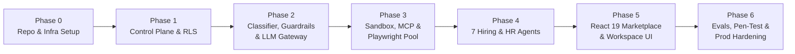

# Rent-an-Agent (Hiring & HR Category) — Implementation Roadmap

> **Status:** Proposed Roadmap (Awaiting User Approval Before Implementation Starts)

---

## 1. Execution Strategy: MVP-First with Day-1 Security Foundations

Rather than building an insecure prototype and retrofitting multi-tenancy later (which almost always causes cross-tenant leakage regressions), this roadmap embeds **PostgreSQL RLS, Auth/Tenant Binding, Token Tracking, and Domain Rejection** into Phase 1, while scoping compute sandboxing, MCP connectors, and observability cleanly between **MVP (Docker Compose)** and **Production (Kubernetes + MicroVMs)**.

---

## 2. Phased Delivery Plan

### Phase 0: Repository & Infrastructure Foundation
* **Scope:** Initialize `Hiring-And-HR-Agent-` repository structure (`backend/`, `frontend/`, `infra/`), Docker Compose stack (PostgreSQL 16 + `pgvector`, Redis 7, MinIO optional local S3, Langfuse local OSS optional), Python 3.12 + FastAPI + SQLAlchemy 2.0 + Alembic + React 19 Vite TypeScript scaffold.
* **Reference Migration Check:** Review `EnterpriseFlow AI` (`ocr_service.py`, `document_verification.py`, `orchestrator.py`) to design clean multi-tenant async equivalents.
* **Exit Criteria:** `docker compose up` boots Postgres (`pgvector`), Redis, and health-checked FastAPI/Vite servers cleanly.

### Phase 1: Multi-Tenant Control Plane, Auth & Database RLS
* **Scope:**
  * Implement Alembic migrations for all tables in `DATABASE_DESIGN.md` with `ENABLE` + `FORCE ROW LEVEL SECURITY` and non-bypass runtime DB user.
  * Implement JWT Auth + RBAC (`TENANT_ADMIN`, `HR_MANAGER`, `RECRUITER`, `EMPLOYEE`), Tenant Context Middleware (`SET LOCAL app.current_tenant`), and `agent_sessions` RLS guard for LangGraph `AsyncPostgresSaver`.
  * Build Control Plane APIs: Marketplace Catalog (seeding the 7 HR agent templates), Rental Provisioning, Rental Config Studio endpoints, and `token_usage_ledger` / `audit_logs` writers.
* **Exit Criteria:** Automated cross-tenant integration tests prove Tenant A cannot query, modify, or resume Tenant B's rentals, sessions, or checkpoints.

### Phase 2: Runtime Lifecycle, 3-Tier Classifier, Guardrails & LLM Gateway
* **Scope:**
  * Implement unified 14-step `lifecycle_pipeline.py`.
  * Build 3-Tier Intent & Domain Classifier (Tier 0 Regex → Tier 1 Embedding Cosine Boundary → Tier 2 `flash-lite` SLM Adjudicator) with strict out-of-domain rejection templates.
  * Implement `injection_detector.py` (including PyMuPDF hidden white/tiny-text detection), `<untrusted_document>` delimiters, `dlp_pii_filter.py`, and `output_validator.py`.
  * Implement `llm_gateway` with model routing (`Tier 0..3`), Gemini client + deterministic fallback, prefix-ordered Prompt Caching layout, and Redis tenant-partitioned Semantic Cache.
* **Exit Criteria:** Adversarial test suite blocks medical/trading/coding queries at <200ms and catches simulated hidden-text resume prompt injections.

### Phase 3: Isolated Execution Plane (Docker Sandbox, MCP Bridge & Playwright)
* **Scope:**
  * Build `docker_runner.py` executing untrusted OCR/PDF extraction and HR Analytics Python scripts in non-root, `--network=none`, `--cap-drop=ALL`, resource-capped containers.
  * Build `browser_manager.py` wrapping hardened non-root Playwright with per-run ephemeral `BrowserContext`, Accessibility Tree / Markdown distillation, and redirect-aware SSRF IP filtering.
  * Build Scoped MCP Registry + Bridge Proxy with AES-256-GCM encrypted tenant secret storage + MVP mock adapters (`MockATS`, `MockCalendar`, `MockHRMS`, `MockSlack`) alongside real Google Calendar / Slack MCP hooks.
* **Exit Criteria:** Redirect SSRF test (`302` → `169.254.169.254` / `127.0.0.1`) is blocked by Playwright route interceptor; sandboxed Python cannot access host filesystem or network.

### Phase 4: The 7 Specialized Hiring & HR Agents
Delivered in three coherent waves sharing `base_hr_agent.py`:
* **Wave 1 (Core Reuse & Grounded RAG):**
  1. **Employee Onboarding Agent** *(Multi-tenant LangGraph upgrade of `EnterpriseFlow AI` with `AsyncPostgresSaver` HITL gates, tenant KYC rules, and MCP adapters).*
  2. **Job Description Generator Agent** *(Leveling KB grounding + inclusive-language bias linter + HITL publish gate).*
  3. **Employee Support & HR Policy Agent** *(Tenant Handbook hybrid RAG + mandatory citations + Redis semantic cache + ticket escalation).*
* **Wave 2 (Recruitment Pipeline):**
  4. **Recruitment & Resume Screening Agent** *(Sandboxed PyMuPDF+RapidOCR + blind-screening PII mask + structured profile caching + rubric scoring).*
  5. **Candidate Shortlisting Agent** *(Deterministic knockout filtering + comparative Markdown matrix + citation verification + mandatory HITL sign-off).*
* **Wave 3 (Scheduling & Analytics):**
  6. **Interview Scheduling Agent** *(SLM slot extraction + deterministic timezone/panel solver + Calendar MCP / Playwright fallback + HITL invite confirmation).*
  7. **HR Analytics Agent** *(RBAC check + `sqlglot` read-only view AST validation + RLS queries + sandboxed Python `matplotlib`/`pandas` charts + $k \ge 5$ anonymity check).*
* **Exit Criteria:** End-to-end chained test (`JD` → `Resume Screening` → `Shortlisting + HITL` → `Scheduling + HITL` → `Onboarding + HITL`) completes across two concurrent mock companies with zero data cross-over.

### Phase 5: Marketplace & HR Workspace Frontend (`React 19 + TypeScript`)
* **Scope:**
  * Marketplace Catalog & One-Click Rental Wizard.
  * Rental Configuration Studio (Prompt/Rubric editor, KB uploader, Tool allowlist toggles, MCP connector setup, Monthly Token Quota slider).
  * Agent Execution Workspace with live SSE trace streaming, source citation cards, and clear out-of-domain rejection banners.
  * Unified HITL Approval Inbox & HR Operations Hub (Jobs, Candidates, Onboarding Tracker, Analytics Charts).
  * Observability & Billing Dashboard (Token usage by rental/model tier, cache hit ratio, audit/guardrail logs).
* **Exit Criteria:** Full user journey runnable end-to-end in browser without manual API calls.

### Phase 6: Evaluation, Security Red-Teaming & Production Hardening
* **Scope:**
  * Run Golden HR Eval Suites across all 7 agents (accuracy, citation faithfulness, token budget compliance, regression check).
  * Security red-team tests: cross-tenant IDOR/RLS probes, indirect PDF prompt injection, SSRF redirect chains, SQL injection via Analytics NL-to-SQL.
  * Production Infrastructure Upgrades: Kubernetes manifests with **gVisor (`runsc`) / Firecracker** worker pools, PgBouncer transaction-mode config, HashiCorp Vault / KMS integration, OpenTelemetry Collector → Langfuse, Qdrant tenant collections, Stripe metered billing hooks.

---

## 3. MVP vs. Production Acceptance Boundaries

| Capability | MVP Deliverable (Phases 0–5) | Production Deliverable (Phase 6+) |
| :--- | :--- | :--- |
| **Tenancy & Auth** | JWT auth, RBAC, PostgreSQL RLS (`SET LOCAL`), encrypted local secret envelopes. | Enterprise OIDC/SAML SSO, HashiCorp Vault / AWS KMS dynamic secret rotation. |
| **Sandboxing** | Ephemeral hardened non-root Docker containers + isolated Playwright `BrowserContext`. | Firecracker microVMs / gVisor Kubernetes pods + Envoy egress proxy firewall. |
| **MCP Integrations** | Full mock ATS/HRMS/Calendar suite + 1–2 real MCP adapters (e.g., Google Calendar, Slack). | Certified production MCP connectors (Greenhouse, Lever, Workday, Okta SCIM, M365). |
| **Token Optimization** | Prefix prompt ordering, Redis semantic cache, Tier 0–3 routing, AXTree distillation, ledger. | Confidence cascading, multi-provider failover, Stripe usage metering. |
| **Observability** | DB `audit_logs`, `guardrail_events`, `token_usage_ledger`, local OTel / Langfuse OSS. | Distributed OTel traces, automated LLM-as-a-judge drift alerts, SIEM WORM export. |

---

## 4. Engineering Risk Register & Honest Limitations

| Risk / Limitation | Impact | Concrete Mitigation |
| :--- | :--- | :--- |
| **Playwright Anti-Bot / CAPTCHA Blocks** | Job boards or external portals (e.g., LinkedIn) frequently block headless browsers or trigger CAPTCHAs. | Use official ATS/API MCPs as the primary integration path; restrict Playwright to tenant-authorized portals; **never bypass CAPTCHAs**—pause and notify the human operator cleanly. |
| **Container Cold-Start Latency** | Spawning a fresh Docker/microVM sandbox per request can add 300ms–1.5s latency. | Maintain a pre-warmed pool of idle, unallocated worker containers assigned to a single `(tenant_id, run_id)` on demand and destroyed immediately post-run. |
| **Automated Hiring Legal Compliance (EEOC / EU AI Act)** | Fully autonomous AI candidate rejection carries legal/bias liability. | Enforce blind-screening PII toggles, mandatory verbatim resume citations, inclusive-language linting, and **mandatory HITL approval gates** before external rejection/offer actions. |
| **PgBouncer + RLS State Leakage** | Session-level PostgreSQL variables persist across pooled requests. | Strictly mandate `set_config(..., is_local=true)` inside explicit database transactions and cover connection pooling under concurrency tests. |
| **Token Spikes on Large Batch Uploads** | A tenant uploading 500 resumes simultaneously could exhaust quotas or provider RPM limits. | Pre-flight token estimation + async job queue backpressure + per-rental Redis rate limiters + structured profile reuse. |

---

## 5. Approval Gate Before Coding

No application code has been written yet. Upon your review and approval of these six design documents:
1. [`SYSTEM_DESIGN.md`](file:///c:/Users/nandan/Desktop/Hiring-And-HR%20Agent/docs/SYSTEM_DESIGN.md)
2. [`AGENT_ARCHITECTURE.md`](file:///c:/Users/nandan/Desktop/Hiring-And-HR%20Agent/docs/AGENT_ARCHITECTURE.md)
3. [`SECURITY_AND_GUARDRAILS.md`](file:///c:/Users/nandan/Desktop/Hiring-And-HR%20Agent/docs/SECURITY_AND_GUARDRAILS.md)
4. [`TOKEN_OPTIMIZATION.md`](file:///c:/Users/nandan/Desktop/Hiring-And-HR%20Agent/docs/TOKEN_OPTIMIZATION.md)
5. [`DATABASE_DESIGN.md`](file:///c:/Users/nandan/Desktop/Hiring-And-HR%20Agent/docs/DATABASE_DESIGN.md)
6. [`IMPLEMENTATION_ROADMAP.md`](file:///c:/Users/nandan/Desktop/Hiring-And-HR%20Agent/docs/IMPLEMENTATION_ROADMAP.md)

We will begin **Phase 0 & Phase 1** in `Hiring-And-HR-Agent-` (leaving `Autonomous-AI-Agents-For-Enterprise-Operations-` untouched).
