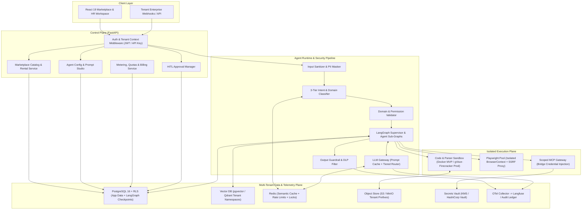

# Rent-an-Agent (Hiring & HR Category) — System Design

> **Status:** Proposed Architecture (Design Phase — No Code Implemented Yet)  
> **Target Repository:** `Hiring-And-HR-Agent-`  
> **Reference Repository (Read-Only):** `Autonomous-AI-Agents-For-Enterprise-Operations-` (*EnterpriseFlow AI*)

---

## 1. Executive Vision & Problem Statement

**Rent-an-Agent** is a multi-tenant B2B AI agent marketplace where businesses discover, rent, configure, and operate specialized AI agents without building AI infrastructure or managing prompt engineering, sandboxing, or LLM orchestration themselves.

This document specifies the complete architecture for the **Hiring & HR Category**, delivering seven specialized agents:
1. **Recruitment & Resume Screening Agent**
2. **Job Description Generator Agent**
3. **Candidate Shortlisting Agent**
4. **Interview Scheduling Agent**
5. **Employee Onboarding Agent**
6. **Employee Support & HR Policy Agent**
7. **HR Analytics Agent**

HR workloads process highly sensitive Personally Identifiable Information (PII), government IDs, salary records, candidate evaluations, and employment contracts across competing businesses. Therefore, **strict tenant isolation, deterministic authorization boundaries, auditable Human-in-the-Loop (HITL) approvals, and predictable token economics** are foundational architectural requirements rather than afterthoughts.

---

## 2. Reference Architecture Analysis (`EnterpriseFlow AI`)

The reference repository (`Autonomous-AI-Agents-For-Enterprise-Operations-`) implements **EnterpriseFlow AI**, a single-tenant multi-agent employee onboarding platform. An audit of its actual codebase reveals clear reusable patterns alongside critical multi-tenant gaps:

| Component in Reference Repo | Actual Implementation Observed | Reusable in Rent-an-Agent? | Gaps Requiring Redesign |
| :--- | :--- | :--- | :--- |
| **LangGraph Pipeline** (`backend/agents/orchestrator.py`, `state.py`) | `StateGraph(AgentState)` with sequential stages (`document_verification` → `it_provisioning` → `team_allocation` → `training` → `monitoring`) and conditional HITL `pause_checkpoint` edges. | **Yes (Core Pattern).** Directly inspires the **Employee Onboarding Agent** sub-graph and HITL gate semantics. | Uses stateless graph re-invocation (`graph.invoke`) with manual DB queries rather than LangGraph persistent checkpointers (`AsyncPostgresSaver`); lacks `tenant_id` or `rental_id` isolation. |
| **OCR & Dual-Model Fallback** (`backend/services/ocr_service.py`, `llm_service.py`) | PyMuPDF (`fitz`) + `RapidOCR` for scanned PDFs/images, paired with Gemini extraction (`10s` thread timeout) and deterministic regex fallback (`_extract_with_rules`). | **Yes (Pattern & Utility).** Excellent cost-resilience pattern for KYC and resume pre-extraction. | Raw `document_text[:1200]` is interpolated directly into an f-string prompt (vulnerable to indirect prompt injection); no token accounting (`usage_metadata` discarded); no semantic/prompt caching. |
| **Database & API Layer** (`backend/db/models.py`, `api/routes.py`, `main.py`) | FastAPI + SQLAlchemy 2.0 + Pydantic v2 + SQLite (`onboarding.db`) + React 19 Vite SPA. | **Yes (Stack Foundation).** FastAPI + Pydantic + React 19 provide a clean developer experience. | Zero authentication, `CORSMiddleware(allow_origins=["*"])`, no `tenant_id` columns, no PostgreSQL Row-Level Security (RLS), no billing/rental/MCP/vector tables. |
| **Upload Storage** (`ocr_service.py`) | Isolates files by `uploads/test_docs/{employee_id}`. | **Partial.** Subfolder scoping idea is good. | Missing `tenant_id` and `rental_id` directory isolation, file-type magic-byte validation, and virus/injection scanning. |
| **Audit Logging** (`backend/services/audit.py`) | Writes agent action entries to `audit_logs` table per `employee_id`. | **Partial.** Conceptually aligned with audit trails. | Lacks `tenant_id`, `rental_id`, `trace_id`, actor identity, token costs, and tamper-evident append-only guarantees. |
| **External Integrations** (`mock_external_apis.py`) | Simulated Okta/ServiceNow/HRMS Python classes. | **MVP Mock Pattern Only.** Good for local demos without live credentials. | No Model Context Protocol (MCP) support, no credential vaulting, no isolated browser automation (Playwright), and no execution sandboxing. |

---

## 3. Technology Stack Evaluation (Why Needed, Alternatives & Limitations)

Every technology in the platform is chosen deliberately based on multi-tenancy, isolation, and cost constraints.

### 3.1 Multi-Tenant SaaS Data Isolation
* **Choice:** **Shared PostgreSQL 16+ Database with Mandatory Row-Level Security (RLS)** enforced via transaction-scoped GUCs (`SET LOCAL app.current_tenant`), combined with **Tenant-Prefixed Object Storage** and **Namespace-Isolated Vector Indexes**.
* **Why Needed:** HR tenants expect logical isolation guarantees where even an application SQL bug cannot leak another company's candidate resumes or salary data, without the operational cost of spinning up dedicated database clusters per small business rental.
* **Alternatives:**
  1. *Silo Model (Database-per-tenant):* Maximum physical isolation, trivial backup per customer, but creates severe schema migration complexity, connection-pool exhaustion, and high base cost at 1,000+ tenants.
  2. *Schema-per-tenant:* Middle ground, but still strains PostgreSQL catalog tables and Alembic migrations as tenant count grows.
  3. *Application-only `WHERE tenant_id = ?`:* Simplest to write, but a single forgotten filter in a complex HR analytics query results in a catastrophic cross-tenant breach.
* **Limitations:** Requires strict discipline with connection pooling (e.g., PgBouncer in transaction mode must use `SET LOCAL` inside explicit transactions, never session-level `SET`), and superuser/migration roles bypass RLS unless configured carefully with `FORCE ROW LEVEL SECURITY`.

### 3.2 Agent Orchestration
* **Choice:** **LangGraph** (`StateGraph` + `AsyncPostgresSaver` checkpointer).
* **Why Needed:** HR workflows (especially shortlisting, interview scheduling, and onboarding) are stateful, multi-step graphs that require deterministic routing, conditional branching, retry loops, and **long-lived HITL pauses** (waiting hours or days for an HR manager to approve an offer or IT ticket).
* **Alternatives:**
  1. *CrewAI / AutoGen:* Higher-level role-playing abstractions, easier to prototype conversational swarms, but offer weaker deterministic state transitions, harder HITL suspension/resumption, and less predictable token budgets.
  2. *Temporal / Prefect + Custom LLM Loops:* Rock-solid durable execution for infrastructure workflows, but lacks native LLM state/message/streaming abstractions (higher boilerplate; viable as an outer durability wrapper in enterprise scale).
  3. *Plain Python `async` state machines:* Zero framework lock-in, but requires reimplementing checkpointing, graph visualization, and interrupt/resume primitives.
* **Limitations:** LangGraph's default `langgraph-checkpoint-postgres` tables (`checkpoints`, `checkpoint_writes`, `checkpoint_blobs`) do not include a native `tenant_id` column. We solve this using an RLS-protected companion `agent_sessions` table mapping `thread_id` ↔ `(tenant_id, rental_id)` before invoking the graph.

### 3.3 Isolated Agent Execution Environments (Sandboxing)
* **Choice:** **Tiered Sandbox Runtime — Hardened Ephemeral Docker Containers (`MVP`) → gVisor (`runsc`) / Firecracker MicroVMs (`Production`)**.
* **Why Needed:** The **HR Analytics Agent** executes dynamically generated Python/pandas analysis scripts, and document parsers process untrusted PDFs/attachments. Running untrusted code or parsers inside the main FastAPI orchestration container risks host compromise, lateral network movement, or cross-tenant memory inspection.
* **Alternatives:**
  1. *In-process Python `exec()` / `RestrictedPython`:* Fast, zero container overhead, but notoriously bypassable via Python introspection gadgets (`__subclasses__`) and vulnerable to C-extension crashes (e.g., malformed PDFs in native parsers).
  2. *Standard Docker Containers (shared host kernel):* Easy to run locally (`MVP`), good namespace/cgroup quotas, but a kernel vulnerability or misconfigured privilege can enable container escape.
  3. *Managed Serverless Sandboxes (E2B / Modal / Cloudflare Workers):* Offloads Firecracker microVM management entirely, accelerating time-to-market, at the cost of external vendor lock-in and per-second billing.
* **Limitations:** Firecracker microVMs require KVM virtualization support (unavailable inside standard Windows/macOS local dev or unprivileged cloud VMs without bare-metal/nested virt). Therefore, hardened non-root Docker with dropped capabilities acts as the MVP boundary, upgrading to gVisor/Firecracker in production Linux clusters.

### 3.4 Tool Architecture (Model Context Protocol — MCP)
* **Choice:** **Scoped MCP Gateway using Bridge Pattern** (per-rental allowlisted MCP servers + backend-injected short-lived credentials).
* **Why Needed:** Businesses rent HR agents to connect to their own ATS (Greenhouse, Lever), HRMS (BambooHR, Workday), Calendars (Google Workspace, M365), and Comms (Slack, Email). MCP standardizes tool discovery and invocation over JSON-RPC without writing bespoke agent glue code per tool.
* **Alternatives:**
  1. *Direct Hardcoded REST Integrations per Agent:* Faster initial wiring for 1–2 APIs, but couples agent reasoning logic tightly to vendor SDKs and duplicates auth/schema logic across all 7 agents.
  2. *OpenAPI-to-Function-Calling Wrappers:* Works for simple REST APIs, but lacks MCP's stateful resource/prompt primitives and standardized local/remote transport ecosystem.
* **Limitations:** The base MCP specification lacks native multi-tenancy (`tenant_id` in protocol handshake) and injecting 30–50 raw MCP tool schemas into an LLM context bloats input tokens dramatically. Our architecture addresses both via a **Tenant-Bound MCP Proxy** and **Lazy/Progressive Tool Loading** (detailed in `SECURITY_AND_GUARDRAILS.md` and `TOKEN_OPTIMIZATION.md`).

### 3.5 Browser Automation
* **Choice:** **Playwright inside Isolated Non-Root Containers with Ephemeral `BrowserContext` per Task and Request-Level SSRF Filtering**.
* **Why Needed:** Many legacy HR portals, background-check systems, university verification portals, and regional job boards lack modern APIs or MCP connectors. Playwright enables deterministic DOM interaction, form filling, and accessibility-tree scraping.
* **Alternatives:**
  1. *Selenium WebDriver:* Mature, multi-language, but slower, flakier async wait handling, and heavier session management than Playwright's `BrowserContext`.
  2. *Managed Browser Clouds (Browserbase / Steel):* Eliminates Chromium memory management, zero-day patching burden, and residential proxy scaling, at higher recurring cost.
  3. *Raw HTTP (`httpx` / `BeautifulSoup`):* Lightweight and low-cost, but fails completely on SPAs (React/Angular ATS dashboards) requiring JS execution.
* **Limitations:** Official Playwright Docker images run as `root` (which disables Chromium's internal sandbox unless configured explicitly with a non-root user + `seccomp`); bundled Chromium requires regular security patching; and HTTP 301/302 redirects can bypass naive entry-URL checks (SSRF). Additionally, Playwright **cannot and must not** bypass CAPTCHAs or anti-bot gates; human handoff or official APIs must be used when gated.

### 3.6 LLM Gateway, Model Routing & Inference Stack
* **Choice:** **Unified LLM Gateway (e.g., LiteLLM / custom provider router)** supporting **Tiered Model Routing** (Rule/Regex → Small Language Model → Mid-tier Flash → Frontier Reasoning Model) with provider-level Prompt Caching.
* **Why Needed:** Running every intent check, resume field extraction, and FAQ reply through a frontier reasoning model destroys SaaS unit margins and increases latency. A gateway centralizes rate limits, fallbacks, token accounting, and cost ceilings per tenant.
* **Alternatives:**
  1. *Direct Single-Vendor SDK (`google-genai` only, as in Reference Repo):* Simple to implement in MVP, but exposes the marketplace to single-provider outages/rate-limits and prevents routing trivial steps to cheaper/local models.
  2. *Self-Hosted Open-Weight Models Only (vLLM / Ollama):* Predictable infra cost and data residency, but requires expensive GPU clusters to match frontier accuracy on complex candidate reasoning and structured tool calling.
* **Limitations:** Different providers use slightly different prompt caching minimum token thresholds and JSON-schema strictness; the gateway must normalize token usage metrics (`input`, `cached_input`, `output`) accurately across providers.

### 3.7 Observability & Tracing
* **Choice:** **OpenTelemetry (OTel) GenAI Semantic Conventions (`gen_ai.*`)** exporting to **Langfuse** (self-hostable open-source) or **Arize Phoenix** alongside immutable PostgreSQL `audit_logs`.
* **Why Needed:** Standard HTTP APM (status 200 OK) hides silent agent failures: infinite tool loops, prompt-injection deflections, low-faithfulness RAG answers, or runaway token burn.
* **Alternatives:**
  1. *LangSmith:* Tightest native LangGraph UX, but proprietary SaaS lock-in (though OTel ingestion is improving) and strict data-residency trade-offs for sensitive HR PII.
  2. *Database-Only String Logs (Reference Repo):* Easy for MVP, zero external services, but lacks hierarchical span trees, latency flamegraphs, and automated evaluation workflows.
* **Limitations:** Tracing full prompts/responses can accidentally store unredacted HR PII in telemetry backends; PII scrubbing must run *before* OTel span export.

### 3.8 Frontend & Real-Time Streaming
* **Choice:** **React 19 + Vite + TypeScript** with **Server-Sent Events (SSE)** for streaming agent reasoning/tool progress and REST for control-plane CRUD.
* **Why Needed:** Reuses team familiarity from `EnterpriseFlow AI` while adding TypeScript safety. SSE streams multi-step LangGraph progress cleanly over standard HTTP/2 without WebSocket proxy headaches.
* **Alternatives:** *Next.js (SSR)* (overkill for an authenticated B2B app dashboard unless public marketplace SEO pages need SSR—can add an SEO landing site later) or *WebSockets* (better only if bidirectional real-time voice/collaboration is needed).
* **Limitations:** SSE is unidirectional (server-to-client); HITL approvals and mid-run cancellations are submitted as separate authenticated POST requests that signal the LangGraph checkpointer.

---

## 4. High-Level System Architecture



---

## 5. Complete End-to-End Request Lifecycle

Below is the exact 14-stage lifecycle requested, mapping control-plane setup to runtime execution:

```mermaid
sequenceDiagram
    autonumber
    actor User as Business User (HR Admin / Recruiter)
    participant UI as Marketplace UI
    participant CP as Control Plane & Auth
    participant IC as Intent & Domain Classifier
    participant PV as Permission Validator
    participant LG as LangGraph Orchestrator
    participant TS as Tool Selector & MCP GW
    participant SB as Sandbox / Playwright
    participant OG as Output Guardrails & DLP
    participant DB as Postgres RLS & Audit Ledger

    rect rgb(30, 41, 59)
        Note over User,CP: Provisioning Phase (Once per Rental)
        User->>UI: 1-2. Browse Marketplace & Rent HR Agent
        UI->>CP: 3. Create Rental (assigns rental_id + tenant_id + quota)
        User->>UI: 4. Configure System Prompt, KB Docs, Allowed Tools & MCP Creds
        CP->>DB: Save encrypted MCP refs, KB embeddings, prompt config
    end

    rect rgb(15, 23, 42)
        Note over User,DB: Runtime Request Phase (Per Task / Query)
        User->>UI: 5. Submit User Request (e.g., "Screen 15 resumes for Backend Role")
        UI->>CP: POST /api/v1/rentals/{rental_id}/invoke (JWT + payload)
        CP->>CP: 6. Verify JWT/RBAC, extract tenant_id, bind Postgres SET LOCAL
        CP->>DB: Verify rental ownership & check token budget remaining
        CP->>IC: 7. Run Input Sanitizer + 3-Tier Intent/Domain Classifier
        alt Out-of-Domain (e.g., Medical / Trading) or Injection Detected
            IC-->>User: Immediate Deterministic Refusal (0-150 tokens) + Log Event
        else In-Domain HR Intent
            IC->>PV: 8. Validate User Role, Rental Scope & Tool Permissions
            PV->>LG: 9. Load Rental Config, Isolated Memory & Resumed Checkpoint
            LG->>TS: 10. Progressive Tool Selection (Allowed Tools Only)
            TS->>SB: 11. Execute inside Sandbox / Isolated Playwright / Scoped MCP
            SB-->>LG: Untrusted Output Wrapped in Delimiters
            opt High-Impact Action (Offer Email / IT Access / Reject Batch)
                LG-->>User: Pause Graph (HITL Gate) -> Await Manager Approval
            end
            LG->>OG: 12. Validate JSON Schema, Citations, Bias & PII/DLP Policy
            OG-->>User: 13. Stream Verified Response (SSE)
            OG->>DB: 14. Commit Immutable Audit Log, OTel Span & Token Usage Ledger
        end
    end
```



### Step-by-Step Lifecycle Specification

1. **Business User**: An authenticated HR Lead, Recruiter, Talent Coordinator, or Employee belonging to a tenant organization (`tenant_id`).
2. **Marketplace**: User browses the **Hiring & HR** catalog (`agent_templates`), inspecting capabilities, required MCP connectors, compliance guarantees, guardrail profiles, and pricing tiers.
3. **Agent Rental**: Subscribing creates a unique `agent_rental` record (`rental_id`) bound permanently to `tenant_id`. Initial budgets, rate limits, isolated vector namespace, and storage prefix (`/{tenant_id}/{rental_id}/`) are provisioned.
4. **Agent Configuration**: Tenant admin customizes company context (e.g., company values, hiring rubric weights, leave policies), uploads KB documents (Employee Handbook, JD templates), toggles allowed tools, connects external MCP credentials (stored in Vault/KMS, never in prompt text), and configures HITL approval policies.
5. **User Request**: User submits a task via Chat UI, Batch Upload, or HRMS Webhook (`POST /api/v1/rentals/{rental_id}/invoke`).
6. **Authentication & Tenant Verification**: API Gateway verifies OIDC/JWT signature (or scoped tenant API key). **Crucial Rule:** `tenant_id` is extracted exclusively from verified auth claims—never from request JSON body or LLM output. A DB transaction opens with `SET LOCAL app.current_tenant = '<tenant_id>'`, verifies `rental_id` ownership and quota balance, and validates `thread_id` against `agent_sessions`.
7. **Intent Classifier**: Prompt injection regex/classifier scans input; semantic cache checks for exact tenant-scoped FAQ hits; 3-tier domain classifier determines whether the query belongs to *this specific rented agent's* HR domain. Out-of-domain queries short-circuit immediately.
8. **Domain & Permission Validation**: Checks RBAC (e.g., can this user invoke `HR Analytics` salary aggregations, or are they an employee restricted to `HR Policy Support`?), validates uploaded file types/paths, and intersects requested actions with `rental.allowed_tools`.
9. **Agent Orchestrator**: LangGraph loads the agent's compiled system prompt, tenant KB retriever, checkpointed state (`AsyncPostgresSaver`), and compressed conversation summary, then drives the plan-act-observe loop within strict `max_steps` and `max_tokens` caps.
10. **Tool Selection**: Progressive tool loader exposes *only* the rental's allowlisted tools and dynamically loads full MCP JSON schemas only for tools needed in the current step.
11. **Sandbox Execution**:
    * Document parsing & Python analytics execute in an ephemeral sandboxed worker (non-root Docker/gVisor/Firecracker) with no internal cluster network access.
    * Browser tasks launch inside an isolated Playwright `BrowserContext` with request-level SSRF filtering.
    * External API calls route through the Scoped MCP Gateway, which injects short-lived tenant OAuth/API credentials server-side.
    * If an action triggers an HITL policy (e.g., sending candidate invites or creating IT tickets), LangGraph checkpoints and suspends cleanly until approved.
12. **Guardrail Validation**: Pre-response pipeline checks JSON schema conformance, verifies grounded citations against retrieved documents/resumes, runs DLP/PII redaction (masking raw Aadhaar/SSN/bank numbers if disallowed for the viewer's role), and checks for biased/discriminatory phrasing.
13. **Response**: Streamed via SSE to the React UI (showing live stage status, evidence cards, or HITL approval cards) or returned as structured JSON to webhook consumers.
14. **Audit Logging & Token Tracking**: Records immutable `audit_logs` (who, what, rental, tools invoked, HITL decision), OTel traces (latency per node), and `token_usage_ledger` (input, cached, output, classifier, guardrail tokens, and USD cost) to update tenant billing meters.

---

## 6. Modular Backend Architecture

```text
backend/
├── app/
│   ├── main.py                        # FastAPI app, lifespan, OTel setup, strict CORS
│   ├── config.py                      # Typed Pydantic Settings (MVP vs Prod flags)
│   ├── core/
│   │   ├── auth.py                    # JWT/OIDC verification, API keys, RBAC decorators
│   │   ├── tenant_context.py          # ContextVar + Postgres SET LOCAL RLS session helper
│   │   └── exceptions.py              # Typed domain/guardrail/quota exceptions
│   ├── control_plane/
│   │   ├── marketplace_service.py     # Catalog discovery of the 7 HR agent templates
│   │   ├── rental_service.py          # Provisioning/deprovisioning isolated rentals
│   │   ├── config_service.py          # Prompt templates, tool allowlists, HITL settings
│   │   └── billing_service.py         # Token quotas, circuit breakers, usage summaries
│   ├── runtime/
│   │   ├── lifecycle_pipeline.py      # Coordinates steps 6 -> 14 uniformly
│   │   ├── intent_classifier.py       # 3-tier router + out-of-domain rejection
│   │   ├── permission_validator.py    # RBAC + rental tool intersection
│   │   ├── checkpointer.py            # AsyncPostgresSaver + RLS agent_sessions guard
│   │   └── hitl_manager.py            # Suspend/resume LangGraph interrupts
│   ├── agents/
│   │   ├── base_hr_agent.py           # Shared tenant-aware LangGraph builder & hooks
│   │   ├── recruitment_screening.py   # Agent 1: Resume parsing & rubric scoring
│   │   ├── jd_generator.py            # Agent 2: Job description creation & bias linting
│   │   ├── candidate_shortlisting.py  # Agent 3: Comparative ranking & HITL shortlist
│   │   ├── interview_scheduling.py    # Agent 4: Calendar negotiation & booking
│   │   ├── employee_onboarding.py     # Agent 5: Adapted from EnterpriseFlow AI
│   │   ├── hr_policy_support.py       # Agent 6: Tenant RAG policy assistant
│   │   └── hr_analytics.py            # Agent 7: Sandboxed Python/SQL HR metrics
│   ├── guardrails/
│   │   ├── injection_detector.py      # Direct & indirect prompt injection filters
│   │   ├── dlp_pii_filter.py          # Presidio/regex PII masking & secret redaction
│   │   ├── bias_compliance_check.py   # Hiring fairness & policy boundary checks
│   │   └── output_validator.py        # Schema & citation grounding verification
│   ├── llm_gateway/
│   │   ├── gateway.py                 # Unified multi-provider client + retry/fallback
│   │   ├── model_router.py            # Tier 0-3 complexity routing
│   │   ├── prompt_cache.py            # Prefix layout manager + KV cache headers
│   │   └── semantic_cache.py          # Tenant-partitioned Redis vector cache
│   ├── sandbox/
│   │   ├── executor.py                # Abstract sandbox interface (Docker / gVisor)
│   │   ├── docker_runner.py           # MVP hardened ephemeral container runner
│   │   ├── browser_manager.py         # Playwright BrowserContext + SSRF route filter
│   │   └── ocr_extractor.py           # Reused PyMuPDF + RapidOCR inside sandbox
│   ├── mcp/
│   │   ├── registry.py                # Per-rental MCP catalog & lazy schema loader
│   │   ├── bridge_proxy.py            # Server-side vault credential injection
│   │   └── connectors/                # Mock (MVP) & real adapters (Calendar, ATS, Slack)
│   ├── knowledge/
│   │   ├── ingestion.py               # Tenant-prefixed upload, chunking, embedding
│   │   └── retriever.py               # Hybrid search + rerank with mandatory tenant filter
│   ├── observability/
│   │   ├── otel.py                    # GenAI semantic convention spans
│   │   ├── token_tracker.py           # Token metering & ledger writer
│   │   └── audit_logger.py            # Tamper-evident append-only audit service
│   ├── db/
│   │   ├── models.py                  # SQLAlchemy 2.0 multi-tenant ORM models
│   │   ├── session.py                 # Async engine + RLS transaction context manager
│   │   └── migrations/                # Alembic migrations (including RLS policies)
│   └── api/v1/                        # Versioned FastAPI routers
└── tests/                             # Tenant isolation, guardrail, & agent eval tests
```

---

## 7. API Surface Design (REST + SSE)

All tenant endpoints require `Authorization: Bearer <jwt>` (or `X-Tenant-API-Key`). `tenant_id` is always derived from the verified credential.

| Group | Method & Endpoint | Purpose |
| :--- | :--- | :--- |
| **Auth** | `POST /api/v1/auth/login`, `GET /api/v1/auth/me` | OIDC/JWT login, active tenant & RBAC role claims. |
| **Marketplace** | `GET /api/v1/marketplace/agents` | Discover the 7 HR agent templates, specs, sample prompts, required MCPs, pricing. |
| | `GET /api/v1/marketplace/agents/{slug}` | Detailed agent template schema, guardrail defaults, and capabilities. |
| **Rentals** | `POST /api/v1/rentals` | Rent an HR agent template for the active tenant (`rental_id` created). |
| | `GET /api/v1/rentals` | List tenant's rented agents, status, and monthly token usage. |
| | `PATCH /api/v1/rentals/{rental_id}/config` | Update custom system prompt, tone, scoring rubric, allowed tools, model tier, HITL rules. |
| | `DELETE /api/v1/rentals/{rental_id}` | Pause/retire rental (retaining audit logs per compliance retention policy). |
| **Knowledge Base** | `POST /api/v1/rentals/{rental_id}/knowledge/upload` | Upload PDFs/DOCX/CSV (handbooks, resumes, JDs) into tenant-isolated KB. |
| | `GET /api/v1/rentals/{rental_id}/knowledge` | List indexed documents & chunk status; `DELETE .../{doc_id}` to purge. |
| **MCP Connectors** | `GET /api/v1/rentals/{rental_id}/mcp` | List available & bound MCP integrations for this rental. |
| | `POST /api/v1/rentals/{rental_id}/mcp/bind` | Store encrypted OAuth/API key in Vault and bind scoped tools to rental. |
| **Execution** | `POST /api/v1/rentals/{rental_id}/invoke` | Synchronous or SSE-streaming execution (`stream=true`); executes full 14-step lifecycle. |
| | `GET /api/v1/rentals/{rental_id}/sessions` | List isolated LangGraph conversation/workflow threads (`agent_sessions`). |
| | `GET /api/v1/executions/{run_id}` | Inspect step-by-step execution state, evidence citations, and artifacts. |
| **HITL Approvals** | `GET /api/v1/approvals?status=pending` | List pending human approval gates across rented HR agents. |
| | `POST /api/v1/approvals/{approval_id}/resolve` | Approve/Reject with reviewer notes & optional parameter overrides; resumes LangGraph. |
| **Domain HR APIs** | `/api/v1/hr/requisitions`, `/candidates`, `/shortlists`, `/interviews`, `/onboarding` | Structured HR entity endpoints backing UI tables and agent read/write views. |
| **Telemetry & Billing** | `GET /api/v1/telemetry/usage` | Token usage breakdown by `rental_id`, model tier, cache hit ratio, USD cost. |
| | `GET /api/v1/telemetry/audit-logs` | Searchable immutable audit & guardrail rejection logs (`tenant_id` scoped). |

---

## 8. Frontend Pages & User Experience (`React 19 + Vite + TypeScript`)

1. **Marketplace Discovery (`/marketplace`)**: Filterable catalog of the 7 Hiring & HR agents, showing capabilities, required connectors, compliance tags (PII-safe, HITL-enabled), cost tier, and "Rent Agent" CTA.
2. **Rental Configuration Studio (`/rentals/:rentalId/configure`)**: No-code configuration wizard—Company Persona & Prompt Overrides, Rubric/Policy Editor, Knowledge Base Uploader, Tool Allowlist Toggles, MCP Connector Credential Binding, HITL Gate Settings, and Monthly Token Budget Cap.
3. **Agent Execution Workspace (`/rentals/:rentalId/workspace`)**: Split-pane workspace:
   * *Left/Center:* Conversational + structured task runner (e.g., batch resume dropzone, JD comparison canvas, onboarding pipeline tracker) streaming live LangGraph nodes via SSE.
   * *Right Inspector:* Live tool calls, retrieved KB/resume citations, token counter per turn, and clear rejection explanations when an out-of-domain query is blocked.
4. **HITL Approval Queue (`/approvals`)**: Unified inbox for HR Managers / IT Admins to review paused LangGraph checkpoints (shortlist sign-offs, offer/interview emails, IT hardware provisioning—extending the approval UI pattern from `EnterpriseFlow AI`) with "Approve & Resume" or "Reject" controls.
5. **HR Operations Hub (`/hr-hub`)**: Domain views for Jobs, Candidates, Scheduled Interviews, Onboarding Employees, and Analytics Dashboards populated by agent runs.
6. **Observability, Guardrails & Billing (`/analytics`)**: Token consumption trends, prompt/semantic cache savings, model-routing tier distribution, guardrail block logs, and exportable compliance audit logs.

---

## 9. MVP vs. Production Infrastructure Matrix

To enable rapid, testable incremental delivery without sacrificing security fundamentals, every layer distinguishes between **MVP (Local / Single-Node Docker Compose)** and **Production (Multi-Node Cloud / Enterprise SLA)**:

| Layer | MVP Scope (Immediate Target) | Production Infrastructure (Scale & Enterprise SLA) |
| :--- | :--- | :--- |
| **Compute & API** | Single-node FastAPI + Uvicorn + React SPA via Docker Compose. | Kubernetes (EKS/GKE) with Horizontal Pod Autoscaling + dedicated worker node pools. |
| **Database & Tenancy** | PostgreSQL 16 (single container) with **RLS policies enabled from Day 1** + Alembic migrations. | Managed HA PostgreSQL (RDS/Cloud SQL) + PgBouncer (transaction mode) + read replicas for HR analytics. |
| **Vector Store** | `pgvector` inside PostgreSQL (enjoys same transaction-scoped RLS automatically). | Dedicated Qdrant or Pinecone with per-tenant collections/namespaces + automated index compaction. |
| **Execution Sandbox** | Hardened non-root ephemeral Docker containers (`--network=none`, `--cap-drop=ALL`, `--read-only`, CPU/RAM limits). | **Firecracker MicroVMs** or **gVisor (`runsc`)** Kubernetes RuntimeClass for hardware/kernel-level isolation. |
| **Browser Automation** | Single hardened non-root Playwright container spawning fresh `BrowserContext` per task + Python route-level SSRF blocker. | Ephemeral per-session headless Chromium pods/containers behind an HTTP egress proxy (Squid/Envoy) enforcing domain allowlists & IP blacklists. |
| **MCP Integrations** | Local mock HR/ATS/Calendar MCP adapters + real Google Workspace / Slack MCP via encrypted DB secrets (Fernet/AES-GCM). | Scoped MCP Gateway sidecars with HashiCorp Vault / AWS KMS dynamic short-lived OAuth token brokering. |
| **LLM Gateway & Cache** | Multi-tier Gemini (`flash-lite` / `flash` / `pro`) + deterministic regex fallback + Redis exact/semantic cache. | Multi-provider Gateway (LiteLLM/Portkey) across Gemini, Anthropic, OpenAI + self-hosted SLM tier + cross-region failover. |
| **Guardrails** | Regex + structural delimiters + lightweight SLM domain/injection classifier + Presidio PII regex/NER. | Fine-tuned DeBERTa/Llama-Guard classifier microservice + automated red-team drift monitoring. |
| **Observability** | Structured JSON logs + `token_usage_ledger` & `audit_logs` tables + OTel local console/Langfuse OSS container. | Full OTel Collector pipeline → Self-hosted/VPC Langfuse + Prometheus/Grafana alerts + SIEM export. |
| **Billing** | Soft/hard monthly token quota caps tracked in `token_usage_ledger`. | Stripe metered billing webhooks synced with real-time Redis token counters. |
